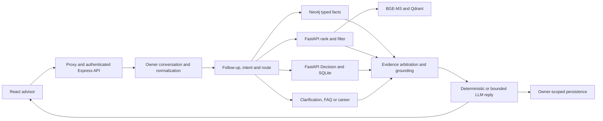
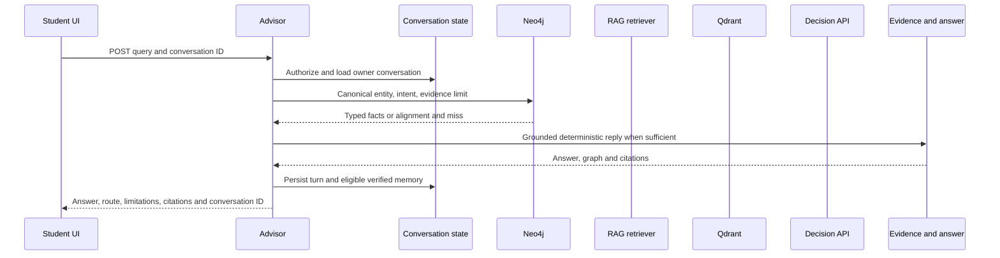
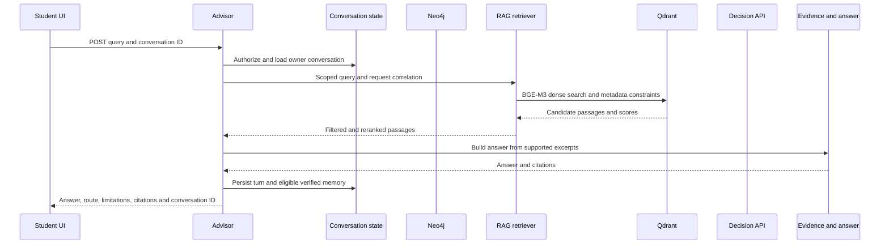
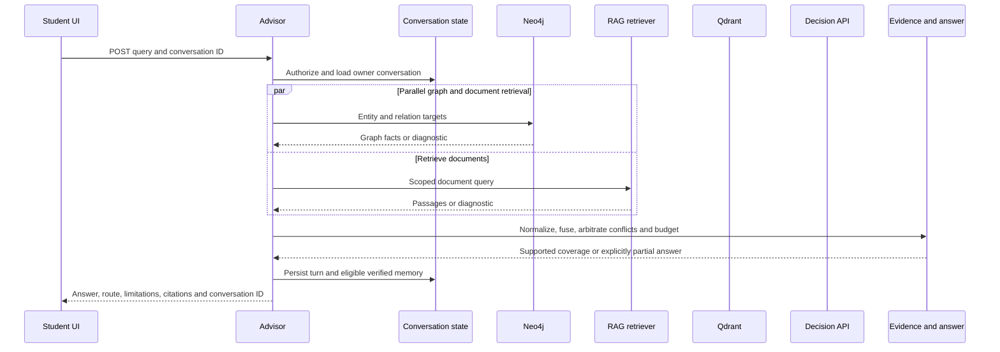
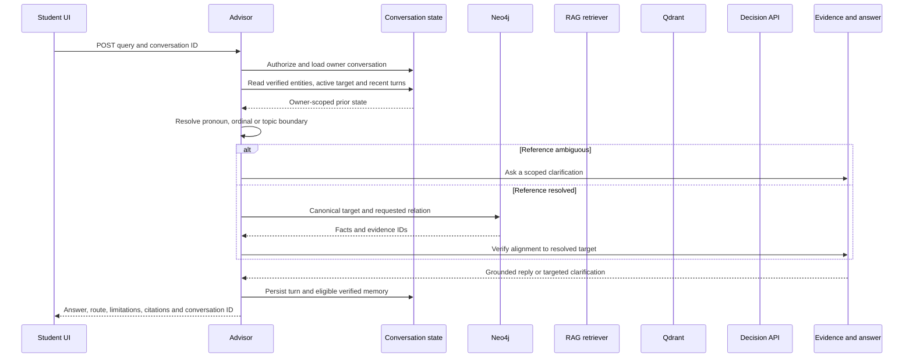
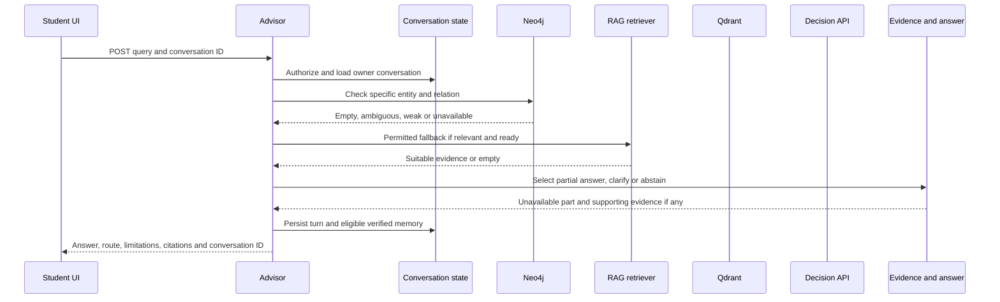
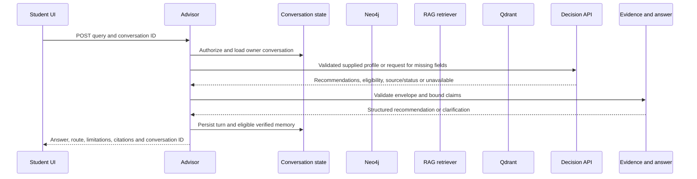

# Actual architecture and data flow

**Stage B · 19 November 2026**

Paths in this report are relative to the source worktree unless specified. The source anchors refer to `6367b0df`. Appliance `4a38cf5f` has the same product topology but different source behavior. Source trace, health/readiness and upcoming live conversation evidence have separate scopes. [Repository baseline](01_REPOSITORY_AND_RUNTIME_AUDIT.md)

| Step | Entry and contracts | Failure, timeout and evidence |
|---|---|---|
| Frontend request | `frontend/src/components/pages/AdvisorPage.tsx:357–443` invokes `frontend/src/services/agentService.ts:90–120`, sending natural text plus existing `cid` with auth. Applies origin/request guard, adopts returned CID and reconstructs citations/graph. | Browser deadline and cancellation in `frontend/src/services/httpClient.ts`. `frontend/testing/frontendCorrectness.test.ts` includes CID continuity and asynchronous navigation. `ChatMessage.tsx:115–133` renders evidence affordances. |
| API and memory | `backend/orchestrator.js:642–794` gates `POST /api/chatbot/query` and `handleChatbotQuery`, sets request ID, serializes per conversation and loads owner memory. `conversationService.js:89,150,176,186,243` stores turns and verified typed context. `persistenceLayer.js:5,75` debounce and atomic rename. | Auth denial and CID ownership fail closed. Tests `authIsolation.test.js`, `demoConversationMemory.test.js`, `demoConversationFollowup.test.js`. Persisted chat is operational data. Diagnostic guests own only artificial conversations. |
| Understanding | `orchestrator.js:841–1025` can bypass for conversational/meta cases. `conversationPriority.js:383,433,482,534,562` detects light/meta and typed references, builds clarifications and per-intent queries. `orchestrator.js:524` optional dynamic classifier. | Lexical rules and memory alignment can diverge. Dynamic LLM intent is disabled by default at `config/runtimeMode.js:37`. Logs include normalization and route diagnostics where emitted. |
| Route | `orchestrator.js:1298–1313` invokes `brainRouter.analyzeQuery` and `determineBestRoute` with contextual signals. `services/brainRouter.js:863,1086–1497` uses route scores, health, deterministic conditions and golden rules. | Requested/effective route can differ. `config/routingCalibration.js:12–21` supplies defaults. `testing/routingPrecisionCalibration.test.js` tests threshold cases. |
| Graph | `orchestrator.js:1685` calls `fetchNeo4jContext`. `services/neo4jcontext.js:3287–3405,3554,4002` resolves exact ID/name/code, detects weak alignment and returns typed facts and graph UI labels. Semantic paths use Nomic query embeddings and Neo4j vector index. | Per-route cutoff near `orchestrator.js:2244–2256`. Exact miss, ambiguous entity, empty graph and timeout are distinct. `kgReliability` and `retrievalEntityAlignment` protect model and relation assumptions. |
| RAG | `services/ragService.js:610,1464` sends scoped query to FastAPI `phase3_retriever.py:1115`. `phase3_retriever.py:794–948` applies embed, Qdrant cosine, metadata filters and reranking. Direct and multi-intent paths can ask different top-K. | Default Node KG 12 s, RAG/hybrid 20 s at `orchestrator.js:2244–2256`, special/golden branches shorter. RAG capability/readiness and fallback retry are separate. `test_phase3_retriever.py` and `directRagGroundingContract.test.js` cover selected cases. |
| Hybrid and missing | `orchestrator.js:2279–2445` can split selected intent families. `2933–3013` runs graph and vector concurrently with settled outcomes. `fusionService.js:56,438–453` merges, dedupes, ranks and bounds evidence on applicable paths. | Target failures may produce partial answer, clarification or eventual generic fallback. `fusionEvidenceContract.test.js` and `fallbackTruthContract.test.js` verify envelope truth. |
| Decision | `orchestrator.js:3040–3094`, `routes/decision.js` and `services/decisionService.js` validate profile and recommendation state or proxy the dedicated form. `college-decision-system-backend/app/api/v1/routers/decisions.py:34–137` invokes typed rule-based ranking. | Requires validated fields, source-aware explanation and explicit error. Decision truth and hermetic API gates. Distinct persistence from the advisor chat. |
| Answer and return | `orchestrator.js:3375–3444` calls unified synthesis or fusion as appropriate. `unifiedAnswerService.js:2249,2767,2990` verifies evidence and uses local primary, optional backup and deterministic fallback. `responseFormatter.js` supports structured response. | `groundingVerificationService.js:346,414` provides heuristic checks. Meta and deterministic branches can bypass model. Provenance, final route, memory and persistence depend on the return path. `ChatMessage.tsx:119–126` render citations. |

Active alternatives include guest/student routes, exact/semantic KG, direct RAG, deterministic multi-intent, normal fusion, career/FAQ, decision form versus conversational decision, and optional local/cloud generation. `services/ragService.js:797` also exposes standalone answer plumbing to the separately deployed Python answer engine. `config/runtimeMode.js:42` makes Gemini humanization optional. Neither configuration nor process presence alone proves use for a given turn. Golden dean scripts call the normal advisor route using synthetic guests. Dean data is a legitimate academic capability. VR source/runtime connector was not found in this tree. See [cleanup inventory](10_DUPLICATE_AND_DEAD_CODE_INVENTORY.md).

The six sequences show applicable branches. The implementation has early replies, scoped gates and fallbacks, so the diagrams cannot be read as one promise that every address or service gets called.

### KG-only

### Document-only

### Hybrid

### Context-dependent follow-up

### Missing evidence

### Decision

