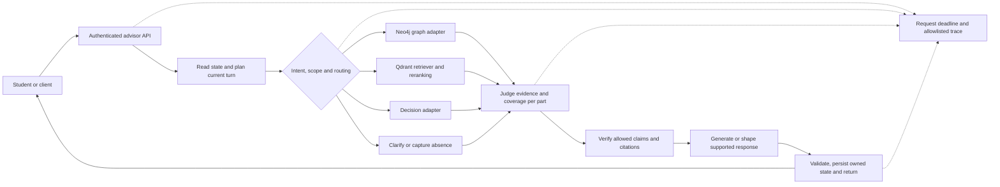

# Target architecture for the advisor

**Stage G · proposed responsibilities and contracts**

Keep one authenticated Node orchestrator, existing Neo4j/Qdrant adapters and the existing Decision proxy. Introduce typed module results in those boundaries. Use the runtime map and saved traces to keep one explicit responsibility per stage. [Actual architecture](02_ACTUAL_ARCHITECTURE_AND_DATAFLOW.md) · [Root causes](06_ROOT_CAUSE_ANALYSIS.md) · [Task contracts](implementation_tasks.json)

| Responsibility | Interface and owner |
|---|---|
| API and lifecycle | Keep `POST /api/chatbot/query` auth, ownership and CID behavior. Set a request ID, deadline and routing context, then return the existing envelope. D1, T-01/T-41/T-60. |
| Memory/state and resolution | Project active targets, recent supported claims, unresolved references and state boundaries from existing per-owner history. The current utterance owns explicit relation, scope and corrections. Borrow earlier slots only when the current utterance omits them. D1, T-10/T-11. |
| Understanding and routing | Form one ordered `QueryPlan`. Classify each part and allow deterministic routes only within their intended scope. Route confidence has a reason and can emit a clarification or scope gap. D1, T-20/T-21. |
| KG and document retrieval | Graph adapter checks target and typed relation/direction. Document adapter recalls and ranks by metadata, authority and scope. Both record candidate visibility and rejection without forcing extra lookups. D2, T-30/T-31. |
| Decision | Existing proxy keeps ownership, tenant/role guards and truth tracking. Convert provided recommendation evidence without inventing labour, fee or admission claims. D1 owns adapter integration, D2 reviews evidence eligibility. |
| Fusion, validation and citations | Adjudicate items per part, deduplicate by source IDs, keep disagreement and check each claim against the selected evidence. A selected item can support more than one compatible part. D2 owns adjudication and selects the contract, D1 owns public mapping. T-40/T-41. |
| Generation, shaping, clarification and abstention | A deterministic or existing model-backed answer consumes selected evidence and missing coverage. Handle why, rephrase and example as transformations of supported content. Ask one question when resolution can change the answer. Preserve gaps, claims and citation scope when shaping. D1, T-50. |
| Observability and resilience | Cross-stage request ID and per-part records, deadline and cancellation signals, health and circuit state, allowlisted logs. A fallback must disclose the affected part and stick to verified evidence. D1, T-01/T-60. |

## Internal contract freeze

| Contract | Required fields and invariants |
|---|---|
| `QueryPlan`, v1 | `requestId`, `parts[]` and `unresolved[]`. Each part has stable `partId`, `goal`, typed subjects with `entityId` when known, `relation`, `timeScope`, `intent`, explicit/borrowed slot markers and an evidence requirement. Keep ordered parts. Corrections never get replaced by inherited slots. |
| `RoutingDecision`, v1 | `partId`, `requestedRoute`, `selectedRoute`, calibrated `confidence` or null, `reason`, `fallbackEligibility` and remaining time. Reason includes explicit rule, ambiguity, unsupported domain, missing evidence or deadline. |
| `EvidenceItem`, v1 | `partId`, source kind, stable source/citation ID, relation or passage context, entity IDs, effective version/scope, optional score and authority, and evidence text with existing disclosure rules. Align with `evaluation/contracts/retrieval` schemas. Per-part result reports available, empty, unavailable or timed out and selected/rejected reason. |
| `Adjudication`, v1 | `partId`, selected evidence IDs, omitted reason and authorized claim-to-ID links. Preserve disagreement and separate absence from a timeout, low confidence or policy mismatch. |
| `DiagnosticTrace`, v1 | Request ID, synthetic case ID, part ID, stage, status, reason, timing, route/model/version when available, and counter/ID allowlist. Capture skipped/unavailable as explicit states. Set size/retention caps. Shared export defaults off. |
| Public reply | Maintain existing `answer`, `cid`, `route`, sources/citations, graph and Decision behavior. T-41 can propose optional per-part coverage only after the two developers freeze defaults and current-client handling. |

Compose, APIs, schema, data indexes, ingestion and models require separate evidence and joint review for any later changes. Compare against existing August grounding and truth helpers before creating new modules. Contract consumers wait for T-01 trace fields, T-21 query plan and T-40 adjudication freezes. [Integration order](16_MASTER_IMPLEMENTATION_ROADMAP.md) · [Owner split](17_TWO_DEVELOPER_WORK_SPLIT.md)
