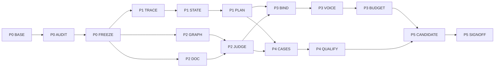

# Dependencies and integration handoffs

Arrows indicate a required accepted output. GRAPH and DOC share one engineer, so they are independent in the graph and normally sequential on the calendar. P1/P2 begin with signed contract examples. P3/P4 begin only when **both completed phase PRs** and their real-interface smoke pass. Release waits for both second-wave PRs. No worker needs the other machine’s filesystem.

| Checkpoint | What each person can do | Required handshake |
|---|---|---|
| Intake | Both fetch the published baseline. Mohammed arranges private cleanup transfer and approved fixture inputs. | Two accounts verify the same pinned source SHA and establish a reviewed PR route. |
| P0 | Teammate reviews the exact cleanup, Mohammed prepares disposable baseline profile and consumer examples. | The approvers agree cleaned commit, replay pack, matched baseline metrics, frozen examples and limits. |
| Wave 1 | Mohammed uses contract-returning doubles to exercise state and route. Teammate feeds the identical example plans into real adapters and judge. | Run at least one exact graph + document split, a missing part and an old single-part call with the actual P1 planner and P2 adapters. Compare IDs, stage events and order. |
| Wave 2 | Mohammed edits public replies and lifecycle in sequence. Teammate runs independent cross-lane and cancellation fixtures through the integrated lower layers. | Compare the same oracle against the new public envelope. Reopen the producing phase if its output fails even with a correct caller. |
| Candidate | Mohammed runs actual HTTP/browser and rollback, teammate verifies attribution, budgets and source parity. | One green integration SHA, OCI identity and two sign-offs. |

The phase queue can land P1 then P2, or the reverse when dependencies and compatibility tests allow it. Use a temporary local merge to prove the handshake before advancing the queue. No artificial T-30 → T-31 dependency survives. Serialize shared orchestrator changes TRACE → STATE → PLAN → BIND → VOICE → BUDGET. Shared-schema changes go through JUDGE with Mohammed as reviewer. Lockfiles and Compose/CI are protected even when a local test setup is inconvenient.

If another developer changes a dependency, pause the affected task, record old/new examples, affected tests and current SHA, and ask its writer to revise the contract. Continue disjoint fixture work. After approval merge the new base normally, rerun both producer and consumer tests, then update the phase PR.
